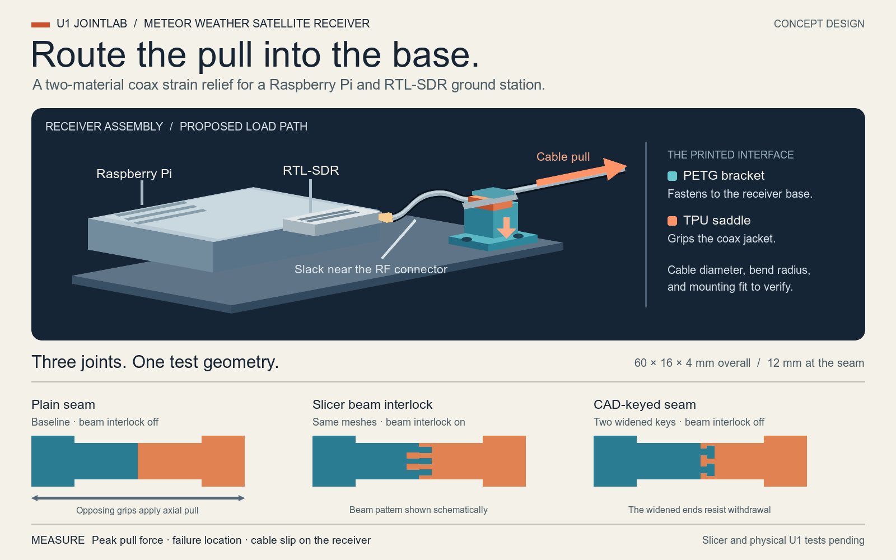

# U1 JointLab

JointLab compares three ways of joining PETG and TPU on the Snapmaker U1. The proposed example is a coax saddle for the Raspberry Pi and RTL-SDR weather satellite receiver. A rigid PETG bracket mounts to the receiver base. The TPU saddle grips the coax jacket upstream of the RTL-SDR connector. Final fit depends on measured cable diameter, minimum bend radius, and mount dimensions.

The test specimens are 60 mm long, 16 mm wide at the jaws and 4 mm thick. The narrow section is 12 mm wide. Both designs have the same outer shape. The keyed joint has two widened PETG keys that engage TPU in the direction of pull. The coax saddle will see a different combination of loads and needs its own fit and pull tests. The STL pairs are comparison specimens. The final station bracket still needs to be modeled.

| Comparison | Meshes | Slicer configuration to check |
| --- | --- | --- |
| Plain seam | plain-petg.stl and plain-tpu.stl | Beam interlocking off |
| Slicer interlock | The same plain pair | Beam interlocking on. Inspect the actual beam pattern in sliced layers. |
| CAD key | keyed-petg.stl and keyed-tpu.stl | Beam interlocking off |

Import each aligned pair as one object with two parts, preserving relative positions. Assign PETG and TPU to separate toolheads in the stock U1 profile. Verify that the two halves still touch in the preview and that the joint in the comparison condition actually changes. Separate the plates if needed to keep experimental settings independent. The meshes are an initial geometry draft. Slicer validation, filament settings, jaw fit, and physical pulls are pending.

Regenerate both pairs with `python3 generate_models.py` from this directory. See the [validation plan](VALIDATION_PLAN.md) for how to capture peak force in newtons, failure mode and print settings.
